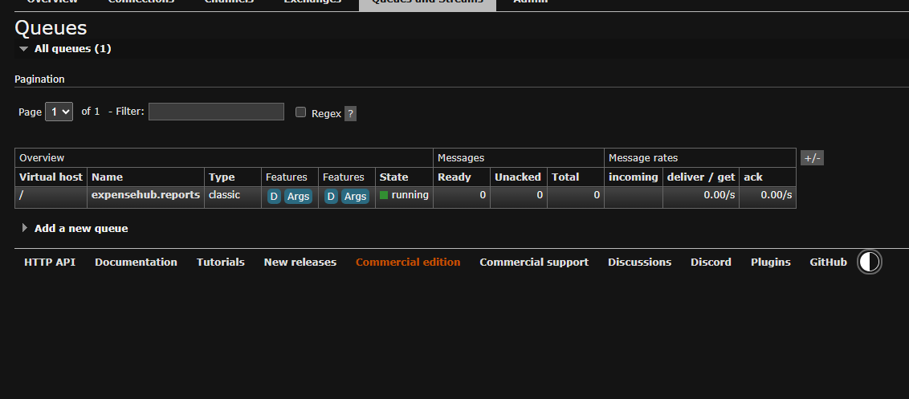
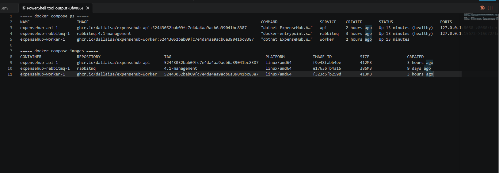
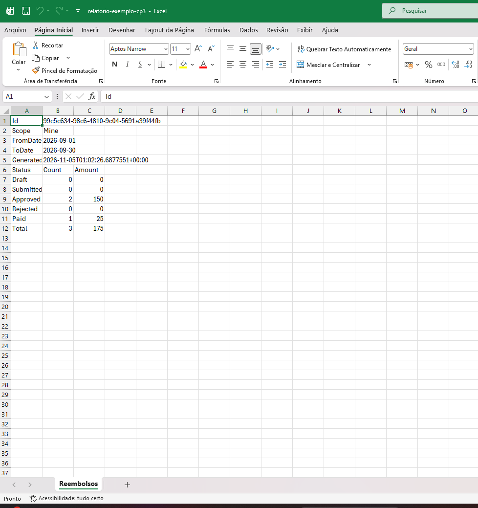

# ExpenseHub — I01 a I10

Versão preparada para concluir:

- **I01 — Fundação da solução e Entity Framework Core**
- **I02 — Identity, Admin e autenticação**
- **I03 — Cadastro HTTP e gerenciamento de roles**
- **I04 — Criar e editar rascunho**
- **I05 — Enviar, listar e consultar**
- **I06 — Ownership e matriz de acesso**
- **I07 — Aprovar e reprovar com justificativa**
- **I08 — Pagamento e histórico**
- **I09 — Testes unitários**
- **I10 — Qualidade de Código**

O **Checkpoint 3 (CP3-I01 a I07)**, com relatórios assíncronos, RabbitMQ, worker, imagens publicadas e experimentos, está
descrito a partir da seção [CP3-I01](#cp3-i01--relatórios-de-reembolsos) e em [Como executar o CP3](#como-executar-o-cp3-docker-compose).

## I01 implementada

- API e projeto de testes mantidos na solução;
- Entity Framework Core com SQLite;
- entidades mínimas `Expense`, `ExpenseCategory`, `ExpenseHistory` e `PaymentRecord`;
- `ExpenseHubDbContext` com mapeamentos relacionais;
- persistência local em `expensehub.db`;
- arquivos SQLite ignorados pelo Git;
- criação reproduzível do banco com `EnsureCreatedAsync`.

## I02 implementada

- ASP.NET Core Identity persistido no mesmo banco relacional;
- roles `Admin`, `Employee`, `Approver`, `Finance` e `Auditor`;
- seed idempotente das roles;
- seed de **somente uma conta Admin**;
- senha do Admin fora do código e fora do `appsettings.json`;
- autenticação bearer;
- `POST /login`;
- proteção de rotas por autenticação e roles;
- usuário anônimo em rota protegida recebe `401 Unauthorized`;
- usuário autenticado sem a role necessária recebe `403 Forbidden`.

## I03 implementada

- `POST /register` para cadastro público de usuários;
- cadastro não aceita nem atribui roles enviadas pelo cliente;
- tentativa de enviar propriedades extras como `role` não promove o usuário;
- validação de email, senha e dados de entrada;
- tratamento de usuário já existente;
- `GET /api/admin/users` restrito à role `Admin`;
- listagem de usuários com identificador, email e roles atuais;
- `PUT /api/admin/users/{id}/roles` restrito à role `Admin`;
- atribuição e remoção das roles permitidas:
  - `Admin`
  - `Employee`
  - `Approver`
  - `Finance`
  - `Auditor`
- roles desconhecidas não são criadas implicitamente;
- usuário inexistente retorna `404 Not Found`;
- entrada ou role inválida retorna `400 Bad Request`;
- o Admin autenticado não pode remover de si mesmo a própria role `Admin`, retornando `409 Conflict`;
- após alteração de roles, o usuário deve realizar um novo login para que o novo token reflita suas permissões atualizadas.

## I04 implementada

- `POST /api/expenses` cria um reembolso sempre em `Draft`, restrito à role `Employee`;
- `PUT /api/expenses/{id}` edita somente um `Draft` do próprio usuário, restrito à role `Employee`;
- identificador gerado pelo servidor;
- proprietário obtido exclusivamente do token (`ClaimTypes.NameIdentifier`);
- a API recebe o DTO `ExpenseRequest` com apenas `description`, `amount`, `expenseDate` e `categoryId`;
  campos como `id`, `ownerId`, `status`, ator ou horários enviados pelo cliente são ignorados;
- validações:
  - descrição obrigatória, entre 10 e 500 caracteres (espaços nas pontas não contam);
  - valor `decimal` entre `0.01` e `2147483647` (`Int32.MaxValue`), com no máximo 2 casas decimais;
  - data da despesa válida e não futura (data UTC do servidor);
  - categoria existente;
- regras de ownership e estado aplicadas no `ExpenseService` e em `ExpenseDraftRules`;
- histórico (`ExpenseHistory`) gravado na mesma chamada de `SaveChanges` da alteração:
  - `Created` na criação (ator, instante UTC, estado anterior nulo, estado posterior `Draft`);
  - `Updated` em cada edição com alteração real, com os campos alterados em JSON (`from`/`to`);
  - edição sem alteração não gera histórico.

### Respostas

| Situação | Status |
|---|---|
| Criação válida | `201 Created` |
| Edição válida | `200 OK` |
| Entrada inválida | `400 Bad Request` (`ValidationProblem`) |
| Sem token | `401 Unauthorized` |
| Autenticado sem role `Employee` | `403 Forbidden` |
| Reembolso inexistente ou de outro usuário | `404 Not Found` |
| Reembolso fora de `Draft` | `409 Conflict` |

### Categorias

As categorias são criadas de forma idempotente na inicialização:

| Id | Nome |
|---:|---|
| 1 | Alimentação |
| 2 | Transporte |
| 3 | Hospedagem |
| 4 | Material de escritório |
| 5 | Outros |

## I05 implementada

- `POST /api/expenses/{id}/submit` executa `Draft → Submitted`, restrito à role `Employee` e ao proprietário;
- o estado é definido exclusivamente pelo servidor; o endpoint não recebe corpo;
- repetir o envio ou enviar fora de `Draft` retorna `409 Conflict` sem gravar histórico;
- o `UPDATE` do envio só é aplicado se o estado no banco ainda for o lido (`Status` como token de concorrência),
  então dois envios simultâneos não geram histórico duplicado;
- histórico `Submitted` com reembolso, ator do token, instante UTC do servidor, estado anterior `Draft` e posterior `Submitted`,
  gravado na mesma chamada de `SaveChanges`;
- `GET /api/expenses` e `GET /api/expenses/{id}` aplicam a mesma matriz de visibilidade (`ExpenseVisibility`):

| Role | Reembolsos visíveis |
|---|---|
| `Employee` | somente os próprios |
| `Approver` | somente `Submitted` |
| `Finance` | somente `Approved` e `Paid` |
| `Auditor` | todos |
| `Admin` | nenhum (`403`), pois Admin não concede acesso funcional |

- roles acumuladas recebem a união das permissões;
- o filtro é uma expressão traduzida pelo Entity Framework para o `WHERE` do SQL, antes de materializar os dados;
- consultas assíncronas e `AsNoTracking`;
- reembolso inexistente ou fora do escopo retorna `404 Not Found`, sem distinguir os dois casos.

### Respostas da I05

| Situação | Status |
|---|---|
| Envio válido / consulta visível | `200 OK` |
| Sem token | `401 Unauthorized` |
| Envio sem role `Employee` | `403 Forbidden` |
| Consulta sem `Employee`, `Approver`, `Finance` ou `Auditor` | `403 Forbidden` |
| Reembolso inexistente, de outro Employee ou fora do escopo | `404 Not Found` |
| Envio repetido ou fora de `Draft` | `409 Conflict` |

## I06 implementada

A autorização combina três camadas:

1. **Autenticação**: política padrão (`FallbackPolicy`) exige usuário autenticado em qualquer rota sem regra explícita;
   somente `/health`, `/login`, `/register` e o OpenAPI (apenas em Development) são públicos.
2. **Role na rota**: cada endpoint exige as roles que podem usá-lo (`403` quando o usuário não tem nenhuma delas).
3. **Regra contextual no serviço** (`ExpenseAccessPolicy` e `ExpenseVisibility`): ownership, estado e visibilidade
   decidem se aquele usuário pode agir sobre aquele reembolso.

Detalhes:

- o serviço recebe a identidade completa (`ExpenseViewer`) e revalida a role funcional, além do atributo da rota;
- criação, edição e envio usam `ExpenseAccessPolicy.EvaluateDraftChange` (Employee, proprietário e `Draft`);
- a busca por reembolso próprio filtra `Id` e `OwnerId` no SQL;
- leitura e listagem usam `ExpenseVisibility`, traduzida para o `WHERE` antes da materialização;
- `ExpenseAccessPolicy.EvaluateApprovalDecision` e `EvaluatePayment` implementam as proibições de
  autoaprovação e autopagamento, inclusive com roles acumuladas; aprovar e reprovar usam essas regras desde a I07,
  e pagar desde a I08;
- Admin não recebe acesso funcional aos reembolsos.

### Matriz aplicada

| Operação | Employee | Approver | Finance | Auditor | Admin | Regra contextual (serviço) | Implementada em |
|---|:---:|:---:|:---:|:---:|:---:|---|---|
| Registrar | público | público | público | público | público | Cadastro nunca aceita role | I03 |
| Login | público | público | público | público | público | Credenciais válidas | I02 |
| Listar usuários | não | não | não | não | sim | Somente Admin | I03 |
| Alterar roles | não | não | não | não | sim | Roles conhecidas; não remover a própria role Admin | I03 |
| Criar reembolso | sim | não* | não* | não | não* | Proprietário vem do token | I04 |
| Editar reembolso | sim | não* | não* | não | não* | Proprietário e `Draft`; outro dono → `404`; fora de `Draft` → `409` | I04/I06 |
| Enviar reembolso | sim | não* | não* | não | não* | Proprietário e `Draft`; outro dono → `404`; fora de `Draft` → `409` | I05/I06 |
| Listar reembolsos | próprios | `Submitted` | `Approved`/`Paid` | todos | não | Filtro no SQL; roles somam | I05 |
| Consultar detalhe | próprio | `Submitted` | `Approved`/`Paid` | todos | não | Fora do escopo → `404` | I05 |
| Aprovar/Reprovar | não | sim | não | não | não | Não proprietário → senão `403`; `Submitted` → senão `409` | I06/I07 |
| Pagar | não | não | sim | não | não | Não proprietário → senão `403`; `Approved` → senão `409` | I06/I08 |
| Consultar histórico | próprio | visível | visível | todos | não | Mesma visibilidade do reembolso | I08 |

`*` A permissão existe apenas se o usuário também possuir `Employee`.

### Decisões de resposta

| Situação | Status |
|---|---|
| Sem token ou token inválido | `401` |
| Autenticado sem a role da rota | `403` |
| Approver/Finance agindo sobre reembolso próprio | `403` (o reembolso é visível, mas a operação é proibida) |
| Reembolso inexistente, de outro Employee ou fora do escopo | `404` |
| Transição fora do estado esperado | `409` |
| Aprovar/reprovar reembolso fora de `Submitted` (`Draft`, `Approved`, `Rejected`, `Paid`) | `409` |
| Pagar reembolso fora de `Approved` (`Draft`, `Submitted`, `Rejected`, `Paid`) | `409` |

## I07 implementada

- `POST /api/expenses/{id}/approve` executa `Submitted → Approved`, restrito à role `Approver`; não recebe corpo;
- `POST /api/expenses/{id}/reject` executa `Submitted → Rejected`, restrito à role `Approver`;
- a reprovação recebe apenas o DTO `RejectExpenseRequest` (`reason`), obrigatório e entre 10 e 500 caracteres
  (espaços nas pontas não contam);
- somente um Approver **não proprietário** decide; o proprietário recebe `403` mesmo acumulando `Employee` e `Approver`;
- ator, horário e estados são definidos pelo servidor; campos extras no corpo são ignorados;
- `Rejected` é final: não há reabertura, cancelamento, reenvio ou nova decisão;
- histórico `Approved`/`Rejected` com reembolso, ator do token, instante UTC do servidor, estado anterior,
  estado posterior e justificativa (na reprovação), gravado na mesma chamada de `SaveChanges` da transição;
- decisão repetida ou fora de `Submitted` retorna `409` sem gravar histórico;
- o `Status` é token de concorrência: duas decisões simultâneas sobre o mesmo reembolso resultam em uma
  aplicada e outra `409`, com um único registro no histórico.

### Respostas da I07

| Situação | Status |
|---|---|
| Decisão válida | `200 OK` |
| Justificativa ausente, vazia, curta ou longa | `400 Bad Request` |
| Sem token | `401 Unauthorized` |
| Sem role `Approver` (Employee, Finance, Auditor, Admin, sem role) | `403 Forbidden` |
| Approver decidindo sobre reembolso próprio | `403 Forbidden` |
| Reembolso inexistente | `404 Not Found` |
| Reembolso fora de `Submitted` ou decisão repetida | `409 Conflict` |

## I08 implementada

- `POST /api/expenses/{id}/pay` executa `Approved → Paid`, restrito à role `Finance`; não recebe corpo;
- somente Finance **não proprietário** paga; o proprietário recebe `403` mesmo acumulando `Employee` e `Finance`;
- o pagamento cria um `PaymentRecord` com o ator do token e o instante UTC do servidor;
- `Paid` é final: não há estorno, nova decisão, edição ou novo pagamento;
- pagar fora de `Approved` (`Draft`, `Submitted`, `Rejected`, `Paid`) retorna `409` sem gravar nada;
- o novo estado, o `PaymentRecord` e o histórico `Paid` são gravados na mesma chamada de `SaveChanges`
  (uma transação); o `UPDATE` só é aplicado se o estado no banco ainda for `Approved`, então dois pagamentos
  simultâneos resultam em um `200` e um `409`, com um único registro de pagamento e de histórico;
- a resposta do reembolso passa a incluir `paidByUserId` e `paidAtUtc` quando ele estiver pago;
- `GET /api/expenses/{id}/history` retorna o histórico em ordem de registro, com a **mesma visibilidade** do
  reembolso (verificada no banco); fora do escopo ou inexistente → `404`;
- cada entrada traz ação, reembolso, ator, instante UTC, estado anterior, estado posterior, justificativa
  (reprovação) e campos alterados (edição em `Draft`).

### Ações registradas no histórico

| Ação | Estado anterior → posterior | Origem |
|---|---|---|
| `Created` | — → `Draft` | I04 |
| `Updated` | `Draft` → `Draft` (com `changes`) | I04 |
| `Submitted` | `Draft` → `Submitted` | I05 |
| `Approved` | `Submitted` → `Approved` | I07 |
| `Rejected` | `Submitted` → `Rejected` (com `rejectionReason`) | I07 |
| `Paid` | `Approved` → `Paid` | I08 |

### Respostas da I08

| Situação | Status |
|---|---|
| Pagamento válido / histórico visível | `200 OK` |
| Sem token | `401 Unauthorized` |
| Pagamento sem role `Finance` (Employee, Approver, Auditor, Admin, sem role) | `403 Forbidden` |
| Histórico sem `Employee`, `Approver`, `Finance` ou `Auditor` | `403 Forbidden` |
| Finance pagando reembolso próprio | `403 Forbidden` |
| Reembolso inexistente; histórico fora do escopo | `404 Not Found` |
| Pagamento fora de `Approved` ou repetido | `409 Conflict` |

## I09 implementada

Testes unitários em `sources/ExpenseHub.UnitTests` (MSTest), executados sem banco de dados, rede,
servidor HTTP ou serviço externo. As regras de negócio ficam em classes de domínio puras
(`ExpenseDraftRules`, `ExpenseDecisionRules`, `ExpensePaymentRules`, `ExpenseAccessPolicy`,
`ExpenseVisibility` e validadores), por isso os testes não precisam de mocks nem de infraestrutura.

```shell
dotnet test ./sources/ExpenseHub.slnx
```

| Arquivo | Regras verificadas |
|---|---|
| `ExpenseStateMachineTests` | Cada ação contra cada estado: só as transições do contrato são aceitas; ações recusadas não alteram estado, histórico nem pagamento |
| `ExpenseDraftRulesTests` | Criação em `Draft` com dono e id do servidor; edição só pelo dono e em `Draft`; histórico `Created`/`Updated` com alterações |
| `ExpenseSubmitRulesTests` | `Draft → Submitted`; repetição sem duplicar histórico; outro usuário; estados inválidos |
| `ExpenseDecisionRulesTests` | Aprovação e reprovação válidas; justificativa no histórico; autodecisão; estado incompatível; `Rejected` final |
| `ExpensePaymentRulesTests` | `Approved → Paid` com `PaymentRecord` e histórico; autopagamento; estados inválidos; pagamento duplicado |
| `ExpenseAccessPolicyTests` | Ownership e decisões contextuais (`404`/`403`/`409`); roles acumuladas; Auditor sem escrita; Admin sem acesso |
| `ExpenseVisibilityTests` | Matriz de leitura por perfil e união de roles |
| `ExpenseHistoryFlowTests` | Histórico completo do fluxo pago e do reprovado; ator, estados e instante UTC |
| `ExpenseRequestValidatorTests` | Descrição, valor, casas decimais, data futura, categoria |
| `RejectExpenseRequestValidatorTests` | Justificativa obrigatória entre 10 e 500 caracteres |
| `ExpenseResponseTests` | Estado por nome e dados do pagamento no contrato da API |

### Capacidade de detectar regressões

Para verificar que os testes falham quando uma regra é quebrada, 19 defeitos simples foram introduzidos
manualmente, um por vez, no código de produção (por exemplo: permitir autoaprovação, permitir
autopagamento, aceitar envio fora de `Draft`, não gravar a justificativa, Employee ver reembolsos alheios,
aceitar data futura, não converter o horário para UTC). Em todos os 19 casos ao menos um teste falhou;
o código original foi restaurado após cada verificação.

## I10 implementada

- `.editorconfig`, `Directory.Build.props`, `.gitattributes`, `.github/`, `docs/`, `scripts/` e `tests/` restaurados
  exatamente como no template oficial; o workflow `code-quality` roda em cada push e publica o artefato
  `code-quality-report`;
- `.gitignore` do template, acrescido das regras do SQLite local (`*.db`, `*.db-shm`, `*.db-wal`) e de `TestResults/`;
- código ajustado à baseline oficial, sem desativar regras: `using` fora do namespace (IDE0065), sem `this.` (IDE0003),
  campos privados com `_` (IDE1006), `using` desnecessário removido (IDE0005) e formatação (IDE0055);
- listagem de usuários do Admin passou a materializar a consulta com `ToListAsync`, sem consulta síncrona no endpoint;
- resultado local do script oficial: **100/100**, status `passed`, nenhum finding.

### Executar o pipeline de qualidade localmente

Requer PowerShell 7 e Gitleaks 8.30.1 (o workflow instala ambos). Na raiz do repositório:

```shell
pwsh ./tests/Invoke-CodeQuality.Unit.Tests.ps1
pwsh ./tests/Invoke-CodeQuality.E2E.ps1
pwsh ./scripts/Invoke-CodeQuality.ps1
```

O relatório é gerado em `artifacts/code-quality/` (`report.json` e `report.md`), pasta ignorada pelo Git.

## Banco de dados

Provider: SQLite.

Pacotes principais:

- `Microsoft.EntityFrameworkCore.Sqlite` 10.0.12
- `Microsoft.EntityFrameworkCore.Design` 10.0.12
- `Microsoft.AspNetCore.Identity.EntityFrameworkCore` 10.0.12

### Configuração

A connection string fica em `sources/ExpenseHub.Api/appsettings.json`, na chave `ConnectionStrings:ExpenseHub`:

```json
"ConnectionStrings": {
  "ExpenseHub": "Data Source=expensehub.db"
}
```

Ela não contém credenciais. Para usar outro arquivo, sobrescreva a chave sem alterar o arquivo, por exemplo com a
variável de ambiente `ConnectionStrings__ExpenseHub`.

### Criação e atualização do banco

O projeto não usa migrations. Na inicialização, `DatabaseInitializer` executa, de forma idempotente:

1. `EnsureCreatedAsync`, que cria o banco e todas as tabelas (domínio e Identity) quando o arquivo não existe;
2. o seed das roles `Admin`, `Employee`, `Approver`, `Finance` e `Auditor`;
3. o seed das categorias de despesa;
4. o seed da conta Admin, somente se `SeedAdmin:Email` e `SeedAdmin:Password` estiverem configurados.

Com `dotnet run --project ./sources/ExpenseHub.Api/ExpenseHub.Api.csproj`, o arquivo é criado em
`sources/ExpenseHub.Api/expensehub.db`.

`EnsureCreatedAsync` não altera um banco que já existe. Na CP3-I01, `ReportSchemaInitializer`
executa uma atualização aditiva e idempotente após essa chamada: cria somente a tabela `Reports`
e seu índice por solicitante quando ausentes. Os dados da CP2 são preservados, sem apagar ou recriar
o arquivo SQLite. Mudanças futuras de esquema precisam de atualização explícita compatível.

Os arquivos locais do SQLite não devem ser versionados:

```text
*.db
*.db-shm
*.db-wal
```

## Configurar o Admin sem versionar senha

O projeto utiliza .NET User Secrets.

Na raiz do repositório:

```shell
dotnet user-secrets set "SeedAdmin:Email" "admin@expensehub.local" --project ./sources/ExpenseHub.Api/ExpenseHub.Api.csproj
dotnet user-secrets set "SeedAdmin:Password" "$ADMIN_PASSWORD" --project ./sources/ExpenseHub.Api/ExpenseHub.Api.csproj
```

Cada desenvolvedor deve configurar os User Secrets localmente em sua própria máquina.

Não coloque a senha do Admin em:

- `README.md`;
- `appsettings.json`;
- arquivos `.http`;
- commits;
- pull requests;
- código-fonte.

## Executar

Requer o .NET SDK 10. Na raiz do repositório:

```shell
dotnet restore ./sources/ExpenseHub.slnx
dotnet build ./sources/ExpenseHub.slnx
dotnet test ./sources/ExpenseHub.slnx
dotnet run --project ./sources/ExpenseHub.Api/ExpenseHub.Api.csproj
```

O build deve concluir com:

```text
0 Error(s)
0 Warning(s)
```

Após o Admin alterar as roles de um usuário, esse usuário precisa fazer login novamente: o token anterior continua
com as roles antigas até expirar.

## Autenticação

### Login

```http
POST /login
```

Exemplo de body:

```json
{
  "email": "usuario@exemplo.com",
  "password": "senha-configurada-pelo-usuario"
}
```

Quando as credenciais forem válidas, a aplicação retorna um token bearer.

Para acessar rotas protegidas:

```text
Authorization: Bearer <accessToken>
```

## Validar I02

1. Configure o Admin por User Secrets.
2. Inicie a aplicação.
3. Faça `POST /login`.
4. Guarde o `accessToken`.
5. Acesse uma rota protegida com:

```text
Authorization: Bearer <accessToken>
```

6. Uma requisição anônima em rota protegida deve retornar `401 Unauthorized`.
7. Um usuário autenticado sem a role necessária deve retornar `403 Forbidden`.

## Validar I03

### Registrar usuário

```http
POST /register
```

Exemplo:

```json
{
  "email": "funcionario@expensehub.local",
  "password": "<senha-local>"
}
```

O cliente não pode atribuir roles durante o cadastro.

Mesmo que seja enviada uma propriedade adicional como:

```json
{
  "role": "Admin"
}
```

o usuário não deve ser promovido.

### Listar usuários

```http
GET /api/admin/users
Authorization: Bearer <AdminToken>
```

Somente um usuário com role `Admin` pode acessar essa rota.

### Alterar roles

```http
PUT /api/admin/users/{id}/roles
Authorization: Bearer <AdminToken>
Content-Type: application/json
```

Exemplo:

```json
{
  "roles": [
    "Employee"
  ]
}
```

Somente as roles conhecidas pelo sistema são aceitas.

Após uma alteração de role, o usuário deve realizar um novo login para receber um token atualizado.

### Casos validados

- cadastro de usuário retorna `201 Created`;
- cadastro não permite autopromoção;
- usuário comum tentando acessar rota Admin recebe `403 Forbidden`;
- Admin consegue atribuir uma role válida;
- role inexistente retorna `400 Bad Request`;
- usuário inexistente retorna `404 Not Found`;
- Admin tentando remover sua própria role `Admin` recebe `409 Conflict`.

## Validar I04

Use um usuário com a role `Employee` (atribuída pelo Admin) e faça login novamente após a atribuição.

### Criar rascunho

```http
POST /api/expenses
Authorization: Bearer <EmployeeToken>
Content-Type: application/json
```

```json
{
  "description": "Almoço com cliente",
  "amount": 150.75,
  "expenseDate": "2026-09-30",
  "categoryId": 1
}
```

### Editar rascunho

```http
PUT /api/expenses/{id}
Authorization: Bearer <EmployeeToken>
Content-Type: application/json
```

```json
{
  "description": "Jantar com cliente",
  "amount": 200.00,
  "expenseDate": "2026-09-30",
  "categoryId": 2
}
```

### Casos validados

- Employee cria `Draft` com proprietário do token: `201 Created`;
- criação sem autenticação: `401 Unauthorized`;
- usuário sem `Employee` (inclusive Admin): `403 Forbidden`;
- descrição fora dos limites, valor inválido, data futura ou categoria inexistente: `400 Bad Request`;
- `ownerId`, `status` ou `id` enviados pelo cliente não alteram os dados controlados pelo servidor;
- proprietário edita o próprio `Draft`: `200 OK`;
- outro Employee tentando editar: `404 Not Found`;
- edição de reembolso fora de `Draft`: `409 Conflict`.

## Validar I05

```http
POST /api/expenses/{id}/submit
Authorization: Bearer <EmployeeToken>
```

```http
GET /api/expenses
Authorization: Bearer <Token>
```

```http
GET /api/expenses/{id}
Authorization: Bearer <Token>
```

### Casos validados

- proprietário envia `Draft`: `200 OK` e estado `Submitted`;
- repetir o envio: `409 Conflict`, sem novo histórico;
- outro Employee tentando enviar: `404 Not Found`;
- Approver ou Auditor tentando enviar: `403 Forbidden`;
- Employee lista somente os próprios reembolsos;
- Approver lista somente `Submitted`;
- Finance lista somente `Approved` e `Paid`;
- Auditor lista todos;
- Employee + Approver lista os próprios e os `Submitted`;
- Admin sem outra role: `403 Forbidden`;
- detalhe fora do escopo: `404 Not Found`;
- rota protegida sem token: `401 Unauthorized`.

## Validar I06

Crie usuários com as roles `Employee`, `Approver`, `Finance`, `Auditor`, `Employee`+`Approver`,
`Employee`+`Finance` e um usuário sem role, além do Admin do seed. Faça login novamente após atribuir roles.

### Casos negativos validados

- requisição anônima ou com token inválido em rota protegida: `401`;
- usuário autenticado sem role: `403` em todas as rotas de reembolso e de administração;
- trocar o identificador na URL não expõe reembolso de outro Employee (`404` em detalhe, edição e envio);
- listagem de um Employee não inclui reembolsos de outros;
- `ownerId`, `status`, `id`, ator e horário enviados pelo cliente são ignorados;
- Auditor lê tudo, mas recebe `403` ao criar, editar, enviar ou alterar roles;
- Admin recebe `403` em todas as rotas de reembolso e continua administrando usuários;
- envio repetido, envio de `Approved`/`Paid` e edição de `Submitted`: `409`;
- Approver lendo `Draft`/`Approved` e Finance lendo `Draft`/`Submitted`: `404`;
- roles acumuladas recebem a união das permissões de leitura;
- autoaprovação: `403` (validada por HTTP a partir da I07); autopagamento: `403` (validado por HTTP a partir da I08).

## Validar I07

```http
POST /api/expenses/{id}/approve
Authorization: Bearer <ApproverToken>
```

```http
POST /api/expenses/{id}/reject
Authorization: Bearer <ApproverToken>
Content-Type: application/json
```

```json
{
  "reason": "Comprovante ilegível, reenviar"
}
```

### Casos validados

- Approver aprova `Submitted`: `200` e estado `Approved`;
- Approver reprova `Submitted` com justificativa válida: `200` e estado `Rejected`, justificativa no histórico;
- reprovação sem corpo, sem justificativa, vazia, curta, longa ou só com espaços: `400`;
- Approver (com ou sem `Employee`) aprovando ou reprovando reembolso próprio: `403`;
- Employee, Finance, Auditor, Admin e usuário sem role: `403`;
- aprovar ou reprovar `Draft`: `409`;
- repetir aprovação ou reprovação, ou decidir sobre `Approved`/`Rejected`: `409`;
- reenviar ou editar `Rejected`: `409`;
- reembolso inexistente: `404`;
- histórico com um único registro por decisão, inclusive com duas aprovações simultâneas.

## Validar I08

```http
POST /api/expenses/{id}/pay
Authorization: Bearer <FinanceToken>
```

```http
GET /api/expenses/{id}/history
Authorization: Bearer <Token>
```

### Casos validados (fluxo completo por HTTP)

- Employee cria, edita e envia; Approver aprova; Finance paga: `200`, estado `Paid`, `PaymentRecord` criado;
- histórico do reembolso pago: `Created`, `Updated` (com `changes`), `Submitted`, `Approved`, `Paid`;
- histórico do reembolso reprovado traz a justificativa;
- campos `actorId`, `paidAtUtc`, `status` e `ownerId` enviados no corpo são ignorados;
- repetir o pagamento (mesmo ou outro Finance): `409`, sem novo registro;
- Employee + Finance pagando o próprio reembolso: `403`;
- pagar `Draft`, `Submitted`, `Rejected` ou `Paid`: `409`;
- Employee, Approver, Auditor, Admin e usuário sem role pagando: `403`;
- editar ou reprovar um `Paid`: `409`;
- dois pagamentos simultâneos: um `200` e um `409`, com um único `PaymentRecord` e um único histórico `Paid`;
- nenhum reembolso `Paid` sem `PaymentRecord` ou sem histórico correspondente;
- Employee consulta histórico próprio (`200`) e não consulta alheio (`404`);
- Auditor consulta qualquer histórico; Approver só de `Submitted`; Finance só de `Approved`/`Paid`;
- Admin ou usuário sem role: `403`; sem token: `401`; inexistente: `404`.

## Qualidade e segurança

O projeto não deve versionar:

```text
bin/
obj/
*.dll
*.exe
*.pdb
*.db
*.db-shm
*.db-wal
```

Também não devem ser versionados:

- senhas;
- tokens;
- connection strings sensíveis;
- User Secrets;
- arquivos locais de execução.

Antes de cada Pull Request:

```shell
dotnet restore ./sources/ExpenseHub.slnx
dotnet build ./sources/ExpenseHub.slnx
dotnet test ./sources/ExpenseHub.slnx
```

O objetivo é manter:

```text
0 Error(s)
0 Warning(s)
```

## GitHub

### I01

```text
branch: i01-foundation-ef
PR: I01 — Fundação da solução e Entity Framework Core
referência: Racass/checkpoint-csharpracass-expensehub#1
```

### I02

```text
branch: i02-identity-auth
PR: I02 — Identity, Admin e autenticação
referência: Racass/checkpoint-csharpracass-expensehub#2
```

### I03

```text
branch: i03-user-roles
PR: I03 — Cadastro HTTP e gerenciamento de roles
referência: Racass/checkpoint-csharpracass-expensehub#3
```

### I04

```text
branch: i04-expense-draft
PR: I04 — Criar e editar rascunho
referência: Racass/checkpoint-csharpracass-expensehub#4
```

### I05

```text
branch: i05-submit-query
PR: I05 — Enviar, listar e consultar
referência: Racass/checkpoint-csharpracass-expensehub#5
```

### I06

```text
branch: i06-ownership-access
PR: I06 — Ownership e matriz de acesso
referência: Racass/checkpoint-csharpracass-expensehub#6
```

### I07

```text
branch: i07-approve-reject
PR: I07 — Aprovar e reprovar com justificativa
referência: Racass/checkpoint-csharpracass-expensehub#7
```

### I08

```text
branch: i08-payment-history
PR: I08 — Pagamento e histórico
referência: Racass/checkpoint-csharpracass-expensehub#8
```

### I09

```text
branch: i09-unit-tests
PR: I09 — Testes unitários
referência: Racass/checkpoint-csharpracass-expensehub#9
```

### I10

```text
branch: i10-code-quality
PR: I10 — Qualidade de Código
referência: Racass/checkpoint-csharpracass-expensehub#10
```

Não use `Closes`, `Fixes` ou `Resolves` nas referências ao backlog central.


## CP3-I01 — Relatórios de reembolsos

Implementação da [issue oficial CP3-I01](https://github.com/Racass/checkpoint-csharpracass-expensehub/issues/11).
O contrato completo, estados, respostas, Excel e passos de integração com o worker estão em
[docs/CP3-I01-RELATORIOS.md](docs/CP3-I01-RELATORIOS.md).

- `POST /api/reports`: recebe somente `fromDate`, `toDate`, `scope`; persiste `Pending`.
- `GET /api/reports`: lista apenas solicitações criadas pelo usuário autenticado.
- `GET /api/reports/{id}`: consulta andamento e resultado salvo de uma solicitação própria.
- `GET /api/reports/{id}/excel`: baixa XLSX real, com valores numéricos, baseado no resultado salvo.
- `Employee` pode solicitar `Mine`; `Auditor` pode solicitar `Global`; roles acumuladas permitem ambos.
- O cálculo considera `ExpenseDate` inclusiva, valores `decimal`, os cinco estados e totais, inclusive zeros.
- O resultado e seu `generatedAt` são persistidos; consultas e downloads não recalculam despesas.

**Integração I03 implementada:** a API usa `RabbitMqReportPublisher` e só retorna `202` com `Location`
após confirmação real do broker. Ausência de confirmação retorna `503` com o ID salvo e erro sanitizado.
O processo separado `ExpenseHub.Worker` calcula e confirma consumo após persistência, com idempotência
persistente. Veja [CP3-I03-RABBITMQ-WORKER.md](docs/CP3-I03-RABBITMQ-WORKER.md) para configuração e limites.

Os testes de relatórios usam fakes e transporte HTTP em memória, sem banco, rede ou broker reais.
O SDK Open XML (licença MIT) gera a planilha e valida sua estrutura nos testes.


## CP3-I02 — Autorização e isolamento de relatórios

A matriz Employee/Mine e Auditor/Global, o isolamento por criador e o cálculo com dados persistidos
foram reaproveitados da I01 e ampliados com testes HTTP para dois Employees e um Auditor.
Identificador, solicitante, escopo, período e criação têm propriedades `init`, impedindo reatribuição
normal depois da construção. O processador recebe apenas o ID, sem identidade ou escopo da mensagem.

A [documentação da CP3-I02](docs/CP3-I02-AUTORIZACAO.md) descreve a matriz, códigos HTTP, casos negativos,
validação e obrigações do futuro worker. A única mudança no retorno provisório da I01 é a adequação
à issue oficial: publicação sem confirmação retorna `503` com ID salvo e erro sanitizado; não há
simulação de broker ou processamento. A suíte completa agora contém 208 testes aprovados.


## CP3-I03 — RabbitMQ, Worker e idempotência

- Cliente RabbitMQ 7.2.1, fila durável `expensehub.reports`, mensagens persistentes contendo somente reportId.
- Confirmação real antes de 202; 503 com ID persistido quando a confirmação não chega.
- Worker independente, consumo manual e ACK apenas após salvar Completed/Failed ou reconhecer terminal salvo.
- Retomada de Processing com concorrência por Status + StartedAt; duplicatas preservam resultado e GeneratedAt.
- Retry limitado em escopos novos; falha de persistência não gera ACK; esgotamento encerra Worker com saída 1.
- Credenciais externas, SQLite existente com caminho absoluto compartilhado e Compose com volume persistente.
- 225 testes unitários + 4 testes de integração SQLite aprovados (229 no total).

O [guia de execução e validação](docs/CP3-I03-RABBITMQ-WORKER.md) contém comandos, variáveis, comportamento
de falhas e janela sem outbox. A execução com broker real foi feita na I06 (veja
[Como executar o CP3](#como-executar-o-cp3-docker-compose)). Não há alegação de entrega exatamente uma vez.


## CP3-I04 — Testes próprios significativos

Testes de comportamento para cálculo, autorização, isolamento, idempotência, resultado persistido e Excel, sem banco,
rede, RabbitMQ ou Docker nos testes unitários. Estado atual: **242 testes unitários e 6 de integração (SQLite descartável)**.

```powershell
dotnet test sources/ExpenseHub.UnitTests/ExpenseHub.UnitTests.csproj
dotnet test sources/ExpenseHub.IntegrationTests/ExpenseHub.IntegrationTests.csproj
```

O mapeamento de cada critério para classe e método está em [docs/CP3-I04-TESTES.md](docs/CP3-I04-TESTES.md).


## CP3-I05 — Publicação e execução reproduzível

- Dockerfiles da web (`sources/ExpenseHub.Api/Dockerfile`) e do worker (`sources/ExpenseHub.Worker/Dockerfile`).
- O workflow `publish-images` publica as imagens no GitHub Container Registry **somente depois de build e testes**, com tag
  igual ao **SHA completo do commit**. Não há tag `latest`.
- `compose.yaml` executa `rabbitmq`, `api` e `worker` a partir das imagens publicadas, com o mesmo SQLite em volume nomeado e
  chaves de autenticação persistentes. Configuração e segredos ficam em um `.env` fora do Git (modelo: `.env.example`).

Detalhes, acesso às imagens e limitações em [docs/CP3-I05-EXECUCAO.md](docs/CP3-I05-EXECUCAO.md).


## CP3-I06 — Experimentos e diagnóstico

O roteiro `scripts/Invoke-Cp3Experiments.ps1` executa E01 a E05 contra o ambiente Compose e grava evidências sanitizadas em
[docs/evidencias/cp3-i06/](docs/evidencias/cp3-i06/). Na rodada oficial, sobre as imagens do commit `5244305`:
**41 verificações aprovadas, 0 falhas**.

| Experimento | Resultado |
|---|---|
| E01 — fluxo normal | 202, `Completed` com 3 reembolsos e R$ 175, Excel `.xlsx` válido |
| E02 — worker parado | mensagem `Ready` na fila e relatório `Pending`; ao retomar, o mesmo id conclui |
| E03 — duplicata | mensagem republicada: resultado e carimbos idênticos, log de duplicata ignorada |
| E04 — isolamento | 403, 401 e 404 de detalhe e Excel alheios, inclusive para o Auditor |
| E05 — persistência e versão | `api` e `worker` recriados: mesma versão e resultado preservado |

O dossiê, o diagnóstico (aceitação × conclusão, worker parado × broker indisponível × janela sem outbox) e os
identificadores estão em [docs/CP3-I06-EXPERIMENTOS.md](docs/CP3-I06-EXPERIMENTOS.md).


## CP3-I07 — Qualidade objetiva das alterações

Comparação entre o commit do CP2 e o estado atual: 0 avisos de build nos dois, configuração de analisadores inalterada,
sem supressões novas e sem binários ou segredos versionados. Veja [docs/CP3-I07-QUALIDADE.md](docs/CP3-I07-QUALIDADE.md).


## Como executar o CP3 (Docker Compose)

Requer Docker com Compose 2.30+ e PowerShell 7 para o roteiro de experimentos.

```powershell
Copy-Item .env.example .env   # preencha; IMAGE_TAG = SHA completo do commit publicado
docker compose pull
docker compose up -d
docker compose ps
```

No `.env`, `SEED_ADMIN_PASSWORD` deve ter maiúscula, minúscula, número e símbolo (política do Identity), e os valores não devem
conter `$`, `#`, aspas, `\` ou espaços. Para parar sem apagar dados: `docker compose stop`. **Não use `docker compose down -v`.**

A API fica em `http://localhost:8080` e o painel do RabbitMQ em `http://localhost:15672`. As chamadas de relatório estão em
`sources/ExpenseHub.Api/ExpenseHub.Reports.http`. Para rodar os cinco experimentos:

```powershell
pwsh scripts/Invoke-Cp3Experiments.ps1 -Experiment All
```

### Evidências

Fila durável `expensehub.reports` no painel do RabbitMQ (etiqueta `D` = durable):



Serviços saudáveis e imagens identificadas pelo SHA do commit:



Relatório concluído exportado em Excel (3 reembolsos, total R$ 175):


